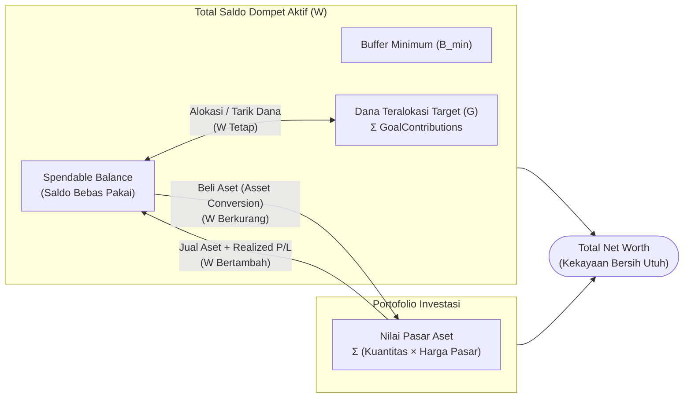
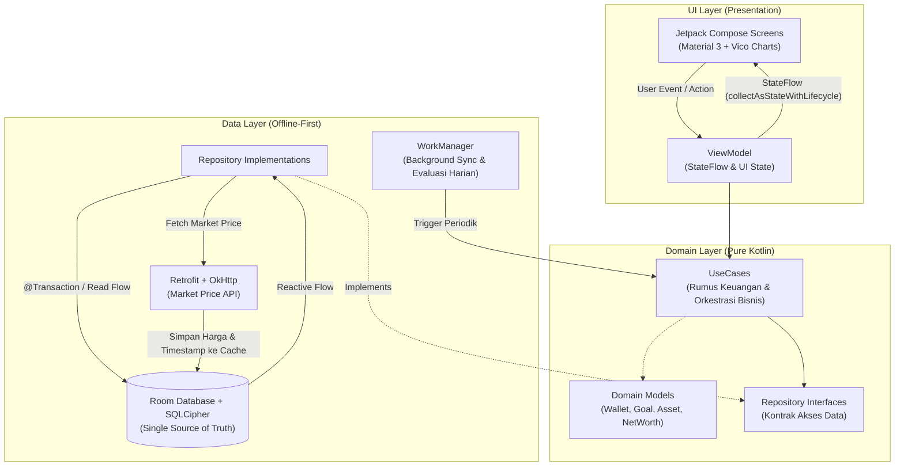
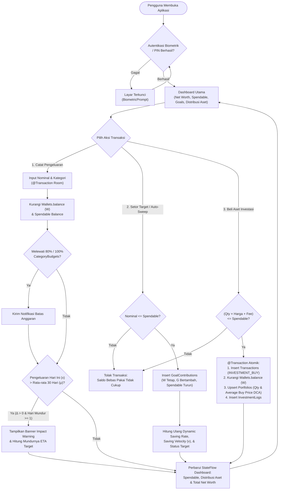
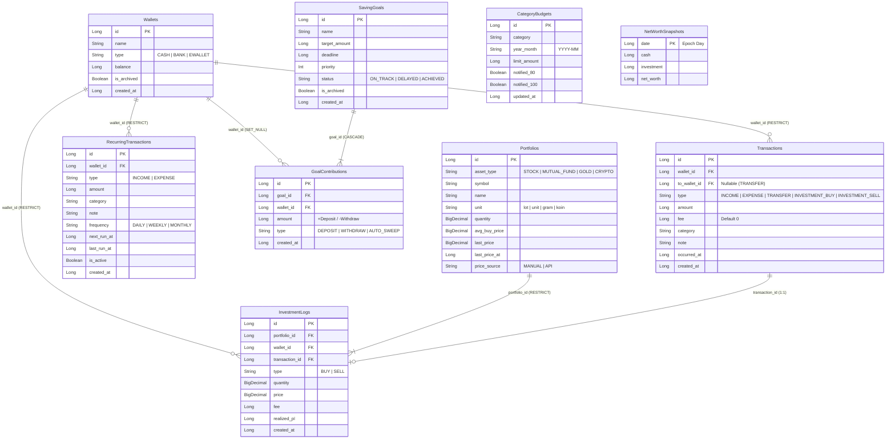
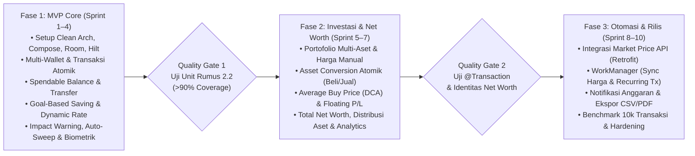

# CatatRapi — Personal Wealth Manager

**CatatRapi** adalah aplikasi *Personal Wealth Manager* berbasis Android (*Offline-First*) yang mengintegrasikan pencatatan arus kas harian, tabungan berbasis target (*Goal-Based Saving*), dan manajemen portofolio investasi ke dalam satu model data terpadu. Setiap rupiah yang Anda miliki selalu memiliki status yang jelas: **Bebas Pakai (*Spendable*)**, **Dialokasikan (*Allocated*)**, atau **Diinvestasikan (*Invested*)**.

---

## Daftar Isi
1. [Latar Belakang & Proposisi Nilai](#1-latar-belakang--proposisi-nilai)
2. [Konsep Inti: Alokasi vs Konversi](#2-konsep-inti-alokasi-vs-konversi)
3. [Arsitektur Sistem & Alur Data](#3-arsitektur-sistem--alur-data)
4. [Flowchart Sistem & Alur Kerja Antar-Modul](#4-flowchart-sistem--alur-kerja-antar-modul)
5. [Fitur Utama (4 Pilar Modul)](#5-fitur-utama-4-pilar-modul)
6. [Skema Database (Room ERD)](#6-skema-database-room-erd)
7. [Tech Stack & Keamanan](#7-tech-stack--keamanan)
8. [Roadmap Pengembangan](#8-roadmap-pengembangan)
9. [Dokumentasi Terkait](#9-dokumentasi-terkait)

---

## 1. Latar Belakang & Proposisi Nilai

Kebanyakan aplikasi pencatat keuangan memisahkan antara saldo kas, tabungan tujuan, dan portofolio investasi, yang memicu tiga masalah utama:
* **Saldo Menyesatkan (*Illusion of Balance*):** Total saldo rekening terlihat besar padahal sebagian dana sudah "dijanjikan" untuk dana darurat, cicilan, atau liburan—memicu *overspending* tanpa sadar.
* **Silo Fitur:** Pengeluaran hari ini tidak memberikan umpan balik langsung terhadap mundurnya tanggal tercapainya target tabungan (*ETA*).
* **Kekayaan Bersih (*Net Worth*) Tidak Terlihat:** Kas dan aset investasi tercatat di aplikasi berbeda sehingga sulit memantau pertumbuhan kekayaan secara utuh.

### Nilai Jual Utama CatatRapi

| Pilar Sistem | Interkoneksi Otomatis | Dampak Nyata bagi Pengguna |
| :--- | :--- | :--- |
| **Core Finance Tracker** | Setiap transaksi langsung memperbarui *Spendable Balance* | Tahu persis berapa nominal uang yang benar-benar aman dibelanjakan hari ini |
| **Goal-Based Saving Engine** | Pengeluaran berlebih memicu *Impact Warning* & menghitung ulang *Dynamic Saving Rate* | Melihat langsung berapa hari target tabungan mundur akibat belanja berlebih |
| **Investment Portfolio Tracker** | Pembelian aset (*Asset Conversion*) memotong kas dan menambah unit portofolio secara atomik | *Average Buy Price* (DCA), *Floating P/L*, dan *Net Worth* selalu akurat tanpa input ganda |

---

## 2. Konsep Inti: Alokasi vs Konversi

Untuk menjaga konsistensi akuntansi dan mencegah penghitungan ganda (*double-counting*) pada **Net Worth**, CatatRapi membedakan perpindahan dana menjadi dua mekanisme:

1. **Alokasi (*Saving Goals*):** Dana yang disetor ke Target Tabungan **tetap berada di dalam dompet fisik/rekening** ($W$ tidak berubah), namun dikunci sehingga mengurangi **Spendable Balance**.
2. **Konversi (*Investment Portfolio*):** Dana yang dibelikan aset investasi **keluar dari saldo dompet** ($W$ berkurang) dan berubah wujud menjadi kuantitas unit aset ($Q_a \times P_{\text{mkt},a}$).

$$\text{Spendable Balance} = W - G - B_{\min}$$

$$\text{Net Worth} = \underbrace{\left(\text{Spendable} + B_{\min}\right)}_{\text{Kas Bebas}} + \underbrace{G}_{\text{Dana Target}} + \underbrace{\sum_{a \in \text{Aset}} Q_a \cdot P_{\text{mkt},a}}_{\text{Nilai Pasar Investasi}}$$

---

## 3. Arsitektur Sistem & Alur Data

CatatRapi dibangun menggunakan **Clean Architecture** dengan pola **MVVM (Model-View-ViewModel)** dan prinsip **Offline-First**. Ketergantungan kode hanya mengarah ke dalam ($\text{UI} \rightarrow \text{Domain} \leftarrow \text{Data}$), dan **Room Database** bertindak sebagai *Single Source of Truth* (SSOT).

---

## 4. Flowchart Sistem & Alur Kerja Antar-Modul

Diagram berikut menggambarkan bagaimana aktivitas harian pengguna (mencatat pengeluaran, menabung ke target, atau membeli aset investasi) mengalir secara atomik dan memperbarui indikator kesehatan finansial secara *real-time*:

---

## 5. Fitur Utama (4 Pilar Modul)

### Modul 1: Core Finance Tracker & Wallet Management
* **Multi-Wallet Management (`FT-01`):** Kelola dompet Kas, Bank, dan E-Wallet secara terpisah dengan fitur pengarsipan aman.
* **Spendable Balance Real-Time (`FT-02`, `FT-03`):** Memisahkan Total Saldo ($W$) dengan Saldo Bebas Pakai ($\text{Spendable} = W - G - B_{\min}$).
* **Transfer Atomik (`FT-04`):** Perpindahan dana antar-dompet dalam satu transaksi database tanpa mengacaukan laporan pengeluaran (kecuali biaya admin).
* **Anggaran Kategori & Transaksi Berulang (`FT-05`, `FT-07`):** Peringatan otomatis pada batas anggaran $80\%$ dan $100\%$, serta pencatatan gaji/langganan otomatis via `WorkManager`.

### Modul 2: Goal-Based Saving Engine
* **Dynamic Saving Rate (`GS-01` – `GS-03`):** Menghitung kebutuhan setoran harian dan mingguan secara dinamis mengikuti sisa hari menuju tenggat.
* **Saving Velocity, ETA & Impact Warning (`GS-04`):** Memantau kecepatan menabung 30 hari terakhir ($v$) dan memberi peringatan konkret berapa hari target mundur ketika belanja harian membengkak ($\Delta > 0$).
* **One-Tap Auto-Sweep Surplus (`GS-05`, `GS-07`):** Memindahkan sisa dana bebas pakai di akhir periode ($\text{Spendable} - B_{\text{sweep}}$) ke target berprioritas tertinggi dalam satu ketukan (dilengkapi *Undo* 10 detik).

### Modul 3: Investment Portfolio Tracker
* **Multi-Asset Portfolio (`IV-01`):** Mendukung Saham (`lot`), Reksadana (`unit`), Emas (`gram`), dan Kripto (`koin`) dengan presisi desimal `BigDecimal`.
* **Atomic Asset Conversion & DCA (`IV-02` – `IV-04`):** Pembelian aset langsung memotong saldo dompet dan menghitung ulang *Average Buy Price* (termasuk biaya transaksi) secara otomatis. Penjualan aset mengembalikan kas dan mencatat *Realized P/L*.
* **Offline-First Valuation (`IV-05` – `IV-07`):** Menampilkan *Floating Profit/Loss* dan ROI menggunakan sinkronisasi API harga pasar atau input manual dengan mekanisme *fallback* bertingkat saat tanpa internet.

### Modul 4: Unified Dashboard & Net Worth Analytics
* **Total Net Worth & Distribusi Aset (`DB-01`, `DB-02`):** Satu angka kekayaan bersih akurat beserta grafik donat komposisi kekayaan (Kas Bebas, Dana Target, dan Kelas Aset Investasi).
* **Laporan Visual & Tren Kekayaan (`DB-03` – `DB-05`):** Grafik tren *Net Worth* historis (`1B/3B/1T/Semua`), evaluasi *Savings Rate* bulanan, serta ekspor laporan ke CSV/PDF.

---

## 6. Skema Database (Room ERD)

Seluruh nominal uang disimpan sebagai `Long` (Rupiah) dan kuantitas/harga aset sebagai `BigDecimal` (disimpan sebagai `TEXT` melalui `TypeConverter`) untuk menghindari galat *floating-point*.

---

## 7. Tech Stack & Keamanan

| Kategori | Teknologi / Library | Keterangan |
| :--- | :--- | :--- |
| **Bahasa & Concurrency** | Kotlin, Coroutines, `StateFlow` | Pemrograman reaktif & *asynchronous* non-blocking |
| **Minimum SDK** | Android 8.0 (`minSdk 26`) | Kompatibilitas modern & dukungan penuh API tanggal/waktu |
| **UI Toolkit** | Jetpack Compose (Material 3) | Deklaratif, *stateless*, mendukung tema gelap/terang & *font scaling* |
| **Visualisasi Grafik** | Vico Chart | Grafik donat distribusi aset, batang arus kas, & garis tren *Net Worth* |
| **Dependency Injection** | Hilt (Dagger) | Injeksi dependensi terstandarisasi pada `ViewModel`, `Repository`, dan `WorkManager` |
| **Local Database** | Room + Paging 3 | Penyimpanan *Offline-First* dengan performa $\le 500\text{ ms}$ untuk $10.000$ transaksi |
| **Networking** | Retrofit + OkHttp | Sinkronisasi harga pasar investasi dengan *offline caching* |
| **Background Processing** | WorkManager | Sinkronisasi harga periodik, evaluasi anggaran harian, & transaksi berulang |
| **Keamanan Lokal** | `BiometricPrompt`, SQLCipher, Android Keystore, `FLAG_SECURE` | Enkripsi database penuh, kunci biometrik/PIN, dan pencegahan *screenshot* di layar finansial |

---

## 8. Roadmap Pengembangan

---

## 9. Dokumentasi Terkait

*  **[Product Requirements Document (PRD)](docs/PRD.md):** Spesifikasi lengkap produk, *user stories*, rumus matematika bisnis, skema tabel Room, spesifikasi layar UI/UX, dan *Non-Functional Requirements*.
*  **[Master Implementation Todos](docs/todos.md):** Daftar tugas (*checklist*) teknis bertahap dari Sprint 1 hingga Sprint 10.
